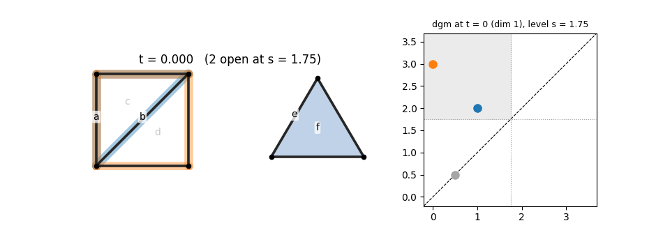
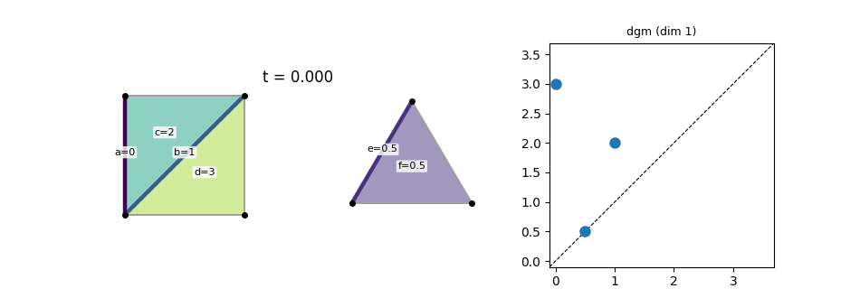
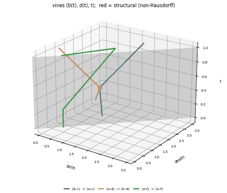

# canopies

**Augmented canopies for 1-parameter fibered filtrations** — exact detection
of non-Hausdorff (structural) points, and computation of trajectories, after
Giunti & Munch, *Canopies: A Generalization of Vines and Vineyards for
Parameterized Persistence*, with the fast updates of Cohen-Steiner,
Edelsbrunner & Morozov, *Vines and Vineyards by Updating Persistence in Linear
Time*.

A vineyard tracks (birth, death) points and, at a crossing, only needs *a*
continuation — it cannot tell a benign swap from a genuine pairing ambiguity.
A canopy tracks pairs of *simplices*, so it decides rigorously whether a
parameter value is a point where the feature matching truly reorganizes, and
records **every** valid continuation rather than silently picking one.

All core arithmetic is exact (`fractions.Fraction`): event times and ties are
computed exactly, never by float comparison. The core has **no dependencies**
beyond the standard library.




### The canopy in 3D

Trajectories live in (birth, death, time) space, above the diagonal wall
`b = d`. Rotating makes the picture readable: from a single viewpoint you
cannot tell which vines genuinely cross from which merely pass behind one
another. The **red** dot is the structural (non-Hausdorff) point at `t = 1/3`,
where two vines meet and the continuation is a real choice rather than a
forced one.

<p align="center">
  
</p>

```python
from canopies.viz import plot_vineyard_3d, animate_vineyard_3d

plot_vineyard_3d(can, dim=1, fname="vineyard3d.png")     # one viewpoint
animate_vineyard_3d(can, "vineyard3d.gif", dim=1)        # a full orbit
```

For a version you can rotate yourself, see
[interactive HTML](#interactive-html) below.

---

## Installation

```bash
pip install canopies                 # core only, pure standard library
pip install "canopies[viz]"          # + matplotlib / numpy / pillow  (plots, GIFs)
```

From a checkout:

```bash
pip install -e ".[dev]"              # editable install with pytest
pytest                               # 19 tests: paper examples + randomized checks
```

Requires Python ≥ 3.9.

---

## Main functionalities

| | what it does | entry point |
|---|---|---|
| **Chosen pairing** | The pairing of a *total* consistent order is unique (Lemma 2.11); computed by Z/2 boundary reduction realizing the split conditions SC1–3. | `pairing_for_order` |
| **Structural point detection** | Decides whether a parameter value is a non-Hausdorff point of the A-canopy (Def. 3.15), by the criterion *"p is structural ⟺ two total consistent orders of g_p yield different chosen pairings"*. **Lazy**: stops at the first disagreement. Separates structural from *coincidental* multiplicity (Ex. 3.16). | `detect_structural` |
| **First structural point** | Walks crossing events in increasing time and returns at the first witness — nothing else is computed. | `find_first_structural` |
| **Full canopy** | Trajectories (Def. 3.6) along the whole path, with *all* valid continuations enumerated at every switch. More than one continuation **is** the non-Hausdorff branching. | `compute_canopy` |
| **Diagrams** | A-mode (diagonal kept) and D-mode (diagonal dropped), matching A- and D-canopies (Def. 4.3), at any parameter value. | `Canopy.diagram` |
| **Fast updates** | `D = R·U` maintained under adjacent transpositions (CEM Cases 1–4, essential variants included): one `O(n³/w)` reduction up front, `O(n/w)` per transposition after. | `RUDecomposition` |
| **I/O** | Dataset files, per-vertex lower-star families, 2-D embeddings. | `canopies.io` |
| **Plots** | Vines in 3D (static or orbiting), persistence-over-time, embedded-complex snapshots, sublevel-set animations with explicit cycle representatives. | `canopies.viz` |
| **Interactive HTML** | Self-contained two-panel HTML (complex + canopy) with a shared time slider, and a dual sweep over both the parameter and the filtration level. No dependencies. | `canopies.html_viz` |

### Package layout

| module | contents |
|---|---|
| `canopies.core` | `Complex`, `PLFiltration`, `RUDecomposition`, `pairing_for_order`, `total_consistent_orders`, `detect_structural`, `compute_canopy`, `find_first_structural` |
| `canopies.io` | `load_dataset`, `from_vertex_functions`, `load_positions` |
| `canopies.viz` | `plot_vineyard_3d`, `animate_vineyard_3d`, `plot_persistence`, `plot_snapshots`, `plot_sublevel_snapshots`, `animate`, `animate_sublevel`, `open_cycles` |
| `canopies.html_viz` | `export_filtration_html`, `export_dual_sweep_html` |
| `canopies.cli` | the `canopies` console script |
| `examples/` | `demo_paper_example.py`, `demo_three_cycles.py`, `demo_paper_viz.py` |
| `tests/` | 19 tests against the papers + randomized cross-checks |

The most-used names are re-exported at top level, so `from canopies import
compute_canopy` works.

---

## Quickstart

```python
from fractions import Fraction as Fr
from canopies import (Complex, PLFiltration, compute_canopy,
                      detect_structural, find_first_structural)

# complex: square with a diagonal (two triangles), labels optional
cx = Complex(
    [(1,), (2,), (3,), (4,),
     (1, 2), (2, 3), (3, 4), (1, 4), (1, 3),
     (1, 2, 3), (1, 3, 4)],
    labels={"a": (1, 4), "b": (1, 3), "c": (1, 3, 4), "d": (1, 2, 3)})

# PL fibered filtration: constant values or (t, value) breakpoints spanning [0,1]
plf = PLFiltration(cx, {
    (1,): -8, (2,): -7, (3,): -6, (4,): -5,
    (1, 2): -3, (2, 3): -2, (3, 4): -1,
    "a": [(0, 0), (1, 2)],        # f_a = 2t
    "b": [(0, 1), (1, 0)],        # f_b = 1 - t
    "c": [(0, 2), (1, 3)],        # f_c = 2 + t
    "d": [(0, 3), (1, 1)],        # f_d = 3 - 2t
})

# 1. lazy: first non-Hausdorff point on the path, nothing else computed
t, det = find_first_structural(cx, plf)          # -> t = 1/3
print(det.describe(cx))

# 2. lazy detection at one parameter value
det = detect_structural(cx, plf.values(Fr(1, 3)))
det.structural                                   # True
det.structural_points(plf.values(Fr(1, 3)))      # {(2/3, 7/3)}

# 3. the whole canopy: trajectories + all events classified
can = compute_canopy(cx, plf, policy="follow_death")   # or "follow_birth"
print(can.summary())
can.structural_points(mode="A")     # [(1/3, {(2/3, 7/3)})]
can.diagram(Fr(1, 2), dim=1)        # A-diagram at t = 1/2
ev = can.first_structural()
ev.matchings                        # ALL valid continuations (the choice!)
```

The bundled dataset is one call away:

```python
from canopies import load_example, compute_canopy

cx, plf = load_example()
can = compute_canopy(cx, plf)
```

---

## Command line

Installing puts a `canopies` script on your PATH (`python -m canopies` also
works):

```bash
# full analysis: events classified, structural points, trajectories
canopies example_dataset.txt
canopies --example                     # use the bundled dataset

# lazy: stop at the FIRST non-Hausdorff point of the path
canopies example_dataset.txt --first-only

# detection at a single parameter value
canopies example_dataset.txt --at 1/3
canopies example_dataset.txt --at 1/2      # -> coincidental, not structural

# with all plots: vineyard 3D, persistence(t), embedding snapshots at the
# structural times, sublevel view at level s = 7/4, animated GIF
canopies example_dataset.txt --dim 1 --plots out \
         --positions example_positions.txt --level 7/4 --gif
```

Useful flags: `--policy follow_birth` (other branch at switches), `--mode D`
(diminished reporting, diagonal dropped), `--no-deep` (skip per-event full
detection; faster), `--max-orders N` (truncate the not-structural proof),
`--times ...` (override the sample grid).

---

## Running on your own data

### Dataset format

One simplex per line: `[label:] v1 v2 ... vk ; val_1 [val_2 ... val_m]`,
values sampled at the times in the `times:` header (default: equally spaced in
[0,1]) and interpolated linearly. A single value means constant. Tokens may be
integers, decimals, or fractions (`2/3`). `#` starts a comment. This extends
the format used by A. Hickok's vineyard code (`v1 v2 ; val val ...`).

```text
times: 0 1/4 1/3 3/4 1
1 ; -14                       # a vertex, constant
1 2 ; -3                      # an edge, constant
a: 1 4 ; 0 1/2 2/3 3/2 2      # labelled edge with 5 samples
c: 1 3 4 ; 2 9/4 7/3 11/4 3   # a triangle
```

`canopies.example_dataset_path()` returns a complete example file, and
`canopies.example_positions_path()` the optional embedding (`vertex x y` per
line).

### From arrays

```python
from canopies import compute_canopy, load_dataset, from_vertex_functions

# from a dataset file
cx, plf = load_dataset("my_dataset.txt")
can = compute_canopy(cx, plf)

# lower-star: a fixed mesh + per-vertex scalar values at sample times
simplices = [(1,), (2,), (3,), (1, 2), (1, 3), (2, 3), (1, 2, 3)]
vertex_values = {1: [0, 0], 2: [1, 2], 3: [2, 1]}     # columns = times 0, 1
cx, plf = from_vertex_functions(simplices, times=[0, 1], vertex_values=vertex_values)
can = compute_canopy(cx, plf)
```

`from_vertex_functions` builds the PL family whose simplex values are the
vertex maxima at each sample time; the face inequalities hold at the samples
and are preserved by linear interpolation, so it is a valid fibered filtration
(a PL approximation of the true lower-star family).

### Interactive HTML

```python
from canopies import load_example, load_positions, compute_canopy, example_positions_path
from canopies.html_viz import export_filtration_html, export_dual_sweep_html

cx, plf = load_example()
can = compute_canopy(cx, plf)
pos = load_positions(str(example_positions_path()))

export_filtration_html(cx, plf, can, pos, "canopy.html", level=7/4)
export_dual_sweep_html(cx, plf, can, pos, "canopy_dualsweep.html")
```

Each call writes one self-contained file: the sublevel set of the embedded
complex on the left, the canopy trajectories in (birth, death, time) on the
right, both driven by a shared slider. Plotly.js loads from a CDN, so nothing
needs installing and the file opens in any browser.

### Examples

```bash
python examples/demo_paper_example.py   # Giunti-Munch running example (Fig. 5):
                                        #   structural at t=1/3, Hausdorff at t=3/4
python examples/demo_three_cycles.py    # three cycles alternating; writes the
                                        #   PNGs and GIFs shown above, including
                                        #   the rotating 3D vineyard
python examples/demo_paper_viz.py       # the same example as interactive HTML
```

Both demos end with `all self-checks passed` assertions, so they double as
integration tests.

---

## Theory → code

The chosen pairing of a **total** consistent order is unique (Lemma 2.11) and
computed by reduction (`pairing_for_order`). Restricting to total orders
removes the pairing freedom of Theorem 2.9, so the only remaining choice is
*which* refinement to take; `total_consistent_orders` enumerates refinements
lazily as products, over tie blocks, of linear extensions of the face poset.

**Detection criterion.** `p` is a structural (non-Hausdorff) point of the
A-canopy ⟺ two total consistent orders of `g_p` yield different chosen
pairings. (⇐) is the constant-projection trajectory of Example 3.12. (⇒):
non-Hausdorff partners share a fiber, and for `q` near `p` every order
consistent with `g_q` is consistent with `g_p`, so any discretized
combinatorial-equivalence chain through a small neighbourhood is realized by
re-orderings of `g_p` alone. The criterion separates structural from
coincidental multiplicity (Ex. 3.16) correctly — see
`test_coincidental_example_3_16` and the `--at 1/2` run above.

**Laziness.** `detect_structural` stops at the first disagreeing order; only
the *not*-structural answer requires exhausting the tie-block extensions (that
direction is a proof over all orders; `max_orders` truncates it).
`find_first_structural` walks crossing events in time order and returns at the
first witness.

**Morozov updates.** `RUDecomposition` maintains `D = R·U` under adjacent
transpositions (CEM Cases 1–4, including essential-class variants), with
id-indexed rows/columns (exchanges move no data) and bitmask columns of `R` /
rows of `U` (every repair is one xor). One `O(n³/w)` reduction at the start;
`O(n/w)` per transposition afterwards, and the update itself reports whether
the pairing switched. Used by `compute_canopy` along the path, by the
detection pre-pass (apply, read the flag, revert), and by the enumeration
fall-back (bubble between successive orders). The consistent order is also
maintained incrementally — only simplices tied at an event can move — so no
per-segment re-sort of exact rationals is needed. On a 523-simplex
triangulated grid with 14,595 events, the full canopy takes ~4 s (it
previously exceeded 45 s), with exact event location now the dominant cost.

**Trajectories.** Between events the pairing is constant; at an event the
old/new pairings are diffed (a change certifies a structural point, since both
one-sided limit orders are consistent *at* the event). All continuations
compatible with filtration equivalence (equal η at t, equal dimension) are
recorded in `SwitchEvent.matchings`; `policy` picks one so a concrete section
is always produced — Morozov-style vineyard algorithms implicitly make this
choice without recording the alternatives; exposing them is precisely the
canopy structure.

---

## Algorithm

```
──────────────────────────────────────────────────────────────
PAIRING(K, ≺)                          # Lemma 2.11 / SC1–3
──────────────────────────────────────────────────────────────
Input:  complex K, total consistent order ≺
Output: the unique chosen pairing P≺
for each simplex τ in order ≺:
    col ← ∂τ  (Z/2 column)
    while col ≠ 0 and pivot(col) used by an earlier column c:
        col ← col + c
    if col ≠ 0: pair (order[pivot(col)], τ)
unpaired creators σ → (σ, ★)                       # essential classes
return P≺                                          # O(n³/w)

──────────────────────────────────────────────────────────────
TRANSPOSE(i)  on the RU-decomposition D = R·U      # CEM Cases 1–4
──────────────────────────────────────────────────────────────
swap positions i, i+1 (σ, τ); if dim σ = dim τ, repair by cases:
  Case 1  σ, τ births:  clear U[σ,τ]; if columns k, l kill σ, τ
          and R[σ, l] = 1: one column addition;
          SWITCH iff pos(l) < pos(k)  (births swap: 1.1.2),
          or, if k absent, l picks up σ and ★ trades (essential variant)
  Case 2  σ, τ deaths:  if U[σ,τ] = 1: add col σ to col τ;
          SWITCH iff low(τ) < low(σ)  (deaths swap: 2.1.2)
  Case 3  σ death, τ birth: if U[σ,τ] = 1: σ and τ trade roles
          (always a SWITCH: 3.1; ★ variant if τ was essential)
  Case 4  σ birth, τ death: clear U[σ,τ]; never a switch
row/col exchanges move no data (id-indexed storage);
each repair = O(1) column/row additions = O(n/w) bit-ops.
Returns whether the pairing switched.

──────────────────────────────────────────────────────────────
ORDERS(K, f)                           # lazy generator, Def. 2.7
──────────────────────────────────────────────────────────────
blocks ← simplices grouped by f-value (tie blocks), sorted by value
yield every concatenation B₁·…·Bₘ, each Bᵢ ranging over the linear
      extensions of the face poset inside block i
# order across blocks is forced by f; only ties vary

──────────────────────────────────────────────────────────────
DETECT-STRUCTURAL(K, f)                # lazy, Def. 3.15
──────────────────────────────────────────────────────────────
base ← first order of ORDERS(K, f);  build RU(base);  P₀ ← its pairing
# pre-pass: O(n/w) per candidate via TRANSPOSE
for each adjacent (σ,τ) in base, tied, non-face-related:
    if TRANSPOSE reports a switch: return STRUCTURAL (witness)
    TRANSPOSE again to revert                # pairing restored (uniqueness)
# fall-back: full lazy enumeration, early exit
for each further order ≺ of ORDERS(K, f):    # capped by max_orders
    bubble the decomposition to ≺ by adjacent TRANSPOSEs
    if pairing ≠ P₀: return STRUCTURAL (witness ≺)
return NOT STRUCTURAL              # proof = all orders visited

──────────────────────────────────────────────────────────────
CROSSINGS(g)                           # candidate events, exact
──────────────────────────────────────────────────────────────
for each pair σ ⊄ τ, τ ⊄ σ:            # face ties never affect the order
    solve g_σ(t) = g_τ(t) on each linear piece (rational arithmetic)
    → isolated roots in (0,1) = events  (with the tied pair recorded)
    → equality on a subinterval = degenerate tie interval
return sorted events, tie intervals               # O(n²·pieces)

──────────────────────────────────────────────────────────────
FIND-FIRST-STRUCTURAL(K, g)            # fully lazy scan
──────────────────────────────────────────────────────────────
for t in CROSSINGS(g) in increasing order:
    if DETECT-STRUCTURAL(K, g_t) = STRUCTURAL: return (t, witness)
return NONE

──────────────────────────────────────────────────────────────
COMPUTE-CANOPY(K, g, policy)           # trajectories, Def. 3.6
──────────────────────────────────────────────────────────────
events ← CROSSINGS(g)
build RU at the first segment's order          # the ONLY full reduction
start one trajectory per pair in P₀
for each event t:
    (deep) DETECT-STRUCTURAL(K, g_t) on a copy of RU   # latent cases
    target ← order after t, updated INCREMENTALLY:
             only the simplices tied at t move; inside each tied group
             re-sort by the values just after t (stable)
    bubble RU to target by TRANSPOSEs; rebuild pairing only if switched
    removed ← P_old \ P_new ;  added ← P_new \ P_old
    if removed ≠ ∅:                            # switch ⇒ structural at t
        M ← all bijections removed → added with η_t(old) = η_t(new)
              and equal birth dimension        # filtration equivalence
        record SwitchEvent(t, M)               # |M| > 1 ⇔ non-Hausdorff choice
        continue trajectories along argmax_M agreement with policy
              (follow_death: keep τ; follow_birth: keep σ)
for each tie interval: DETECT-STRUCTURAL at its midpoint; warn if structural
return trajectories Γ(t) = (t, σ(t), τ(t)), events with all matchings,
       structural diagram points (A: keep diagonal, D: drop it)
```

Invariants used throughout: the diagram η(π⁻¹(t)) is order-independent
(Lemma 2.14), so only the *pairing* can distinguish orders; a switch at an
event is automatically structural because both one-sided limit orders are
consistent at t itself; and the pairing of a total order is unique
(Lemma 2.11), which is what makes the TRANSPOSE-and-revert pre-pass and the
switch flags sound. The only expensive branch is proving NOT STRUCTURAL, which
must exhaust the tie-block extensions; every other path exits at the first
witness.

*The estimated complexity:*

```
T =  O( n²·β·M(L) )                                   (1) event location, exact
  +  O( n³/w )                                        (2) one initial reduction
  +  Σ_{t∈E} O( g_t·log g_t · M(L) )                  (3) incremental order update
  +  Σ_{t∈E} O( inv_t · n/w )                         (4) transposition repairs
  +  Σ_{t∈E} O( n·M(L) + c_t·n/w + (N(t)−1)·inv_t·n/w )  (5) deep detection at t
  +  Σ_{switches}  O( n  +  n·M(L)·[if deep=False]  +  r_t! · r_t )  (6) pairing rebuild + matchings
```

Then,

```
deep=False:  T = O( n²·β·M(L) + n³/w + m·n/w + m_s·n·M(L) )
deep=True:   T = O( n²·β·M(L) + n³/w + m·n·M(L) )
```

---

## Caveats

- Proving *not structural* costs the product of linear-extension counts of the
  tie blocks (factorial for large all-incomparable blocks); use `max_orders`.
  Structural answers usually arrive within a handful of orders.
- If many unrelated simplices share one constant value (e.g. "everything else
  enters at 0"), the diagonal `(0,0)` pairs are swappable and every parameter
  is structural in the strict A-sense. Give base simplices distinct values, or
  report with `mode="D"`.
- Two simplices equal on a whole subinterval are reported as `tie_intervals`
  (order ambiguous there; the chosen section is one valid choice).
- Exact event location is `O(n² · pieces)` in rational arithmetic and dominates
  for large inputs.
- Representative cycles drawn by the sublevel plots are valid but not
  canonical; after a switch, which geometric cycle carries which trajectory
  color follows the chosen `policy` — that is the non-Hausdorff choice.

---

## References

The papers this implementation is based on. Neither their authors nor their
institutions are involved in this package.

- B. Giunti, E. Munch, *Canopies: A Generalization of Vines and Vineyards for
  Parameterized Persistence*.
- D. Cohen-Steiner, H. Edelsbrunner, D. Morozov, *Vines and Vineyards by
  Updating Persistence in Linear Time*, SoCG 2006.

## Author

Eduardo Paluzo-Hidalgo — <epaluzo@us.es>
([ORCID 0000-0002-4280-5945](https://orcid.org/0000-0002-4280-5945))

## Citing

Citation metadata lives in [`CITATION.cff`](CITATION.cff).

This is an independent implementation. It builds on the two papers listed under
[References](#references), but it is not affiliated with, endorsed by, or the
product of collaboration with their authors — please cite those papers for the
theory and this package for the software, separately.

## License

MIT — see [LICENSE](LICENSE).

## Acknowledgments

This code was produced during my visit at the University of Tokyo host by Prof. Yuichi Ike. E.P-H is supported by the European Union’s Horizon 2020
research and innovation programme under the Marie Skłodowska-Curie grant agreement No. 101153039 (CHALKS).
